<div align="center">



<br/>


[](https://samarth-rawat-portfolio.vercel.app)
[](https://www.kaggle.com/samarthrawat18)



</div>

## `01` · about me

Hi, I'm Samarth 👋 I graduated from **KIIT University** in 2026 and joined **Accenture Indore** in July as an AI/ML Computational Science Associate.

I like the detective side of data: exploring a messy dataset, testing a hunch with statistics, and building a model when it's the right tool. Lately I'm also learning embedded C, because I'm curious how code meets hardware.

```python
class Samarth:
    role         = "AI/ML Computational Science Associate @ Accenture"
    base         = "Bhopal, Madhya Pradesh, India"
    education    = "B.Tech, Information Technology, KIIT University (2026)"
    works_with   = ["Python", "R", "EDA", "Statistics", "ML", "GenAI"]
    learning     = ["ML model development", "Embedded C"]
    ask_me_about = ["hypothesis testing", "unsupervised learning",
                    "turning messy data into answers"]

    def mood(self):
        return "curious"
```

<div align="center">

</div>

## `02` · toolbox

<table>
  <tr>
    <th align="left">🟢 Daily drivers</th>
    <th align="left">🔵 Leveling up</th>
    <th align="left">🟡 Just exploring</th>
  </tr>
  <tr valign="top">
    <td>Python · R<br/>pandas · NumPy<br/>EDA &amp; visualization<br/>Inferential statistics<br/>Hypothesis testing<br/>Unsupervised learning</td>
    <td>ML model development<br/>Pattern detection<br/>scikit-learn<br/>GenAI workflows</td>
    <td>Embedded programming in C<br/>(beginner, loving it)</td>
  </tr>
</table>

<div align="center">


<br/><br/>


</div>

## `03` · github activity

<div align="center">


</div>

<!--
## `04` · featured projects   (uncomment once you pick your projects)

| Project | What it does | Stack |
|---|---|---|
| [project-name](https://github.com/gentlewind-alt/project-name) | One line on the problem and the result | Python · pandas · scikit-learn |
-->

<div align="center">


<sub>Always happy to talk data, ML, or new ideas. Say hi 🍃</sub>

</div>
